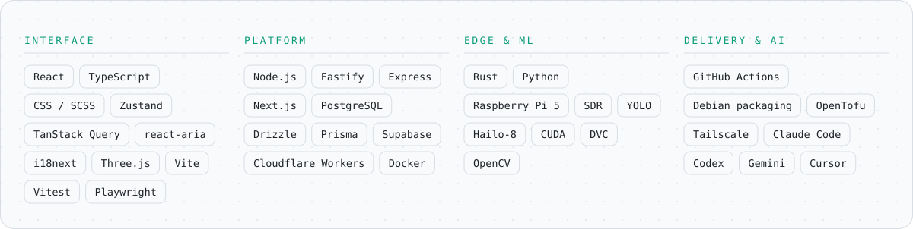
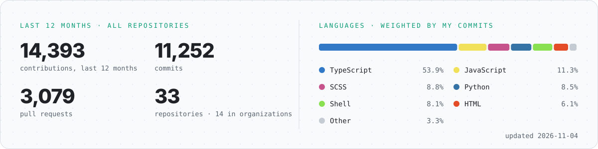

<picture>
  <source media="(prefers-color-scheme: dark)" srcset="assets/hero-dark.svg" />
  
</picture>

I lead frontend on products where the interface is half the story: a production studio for conversational AI avatars, and drone detection that runs on a Raspberry Pi in the field. React, TypeScript and CSS are home ground. Around them I build what the interface needs to be real: the backend, the device software, the models and the release pipeline that ships it all.

Most of my work lives in private organization repositories, so the public repos here show only a small part of it. The numbers below count all of it.

Київ. Фронтенд-лід: від інтерфейсів AI-аватарів до виявлення дронів на edge-пристроях.

 

<picture>
  <source media="(prefers-color-scheme: dark)" srcset="assets/now-dark.svg" />
  
</picture>

<picture>
  <source media="(prefers-color-scheme: dark)" srcset="assets/stack-dark.svg" />
  
</picture>

<picture>
  <source media="(prefers-color-scheme: dark)" srcset="assets/stats-dark.svg" />
  
</picture>

<picture>
  <source media="(prefers-color-scheme: dark)" srcset="https://raw.githubusercontent.com/Hlybchenko/Hlybchenko/output/github-contribution-grid-snake-dark.svg" />
  
</picture>

<a href="mailto:hlybchenko@gmail.com">hlybchenko@gmail.com</a> · Kyiv, Ukraine · assets are hand-built SVG, stats refresh daily via GitHub Actions

